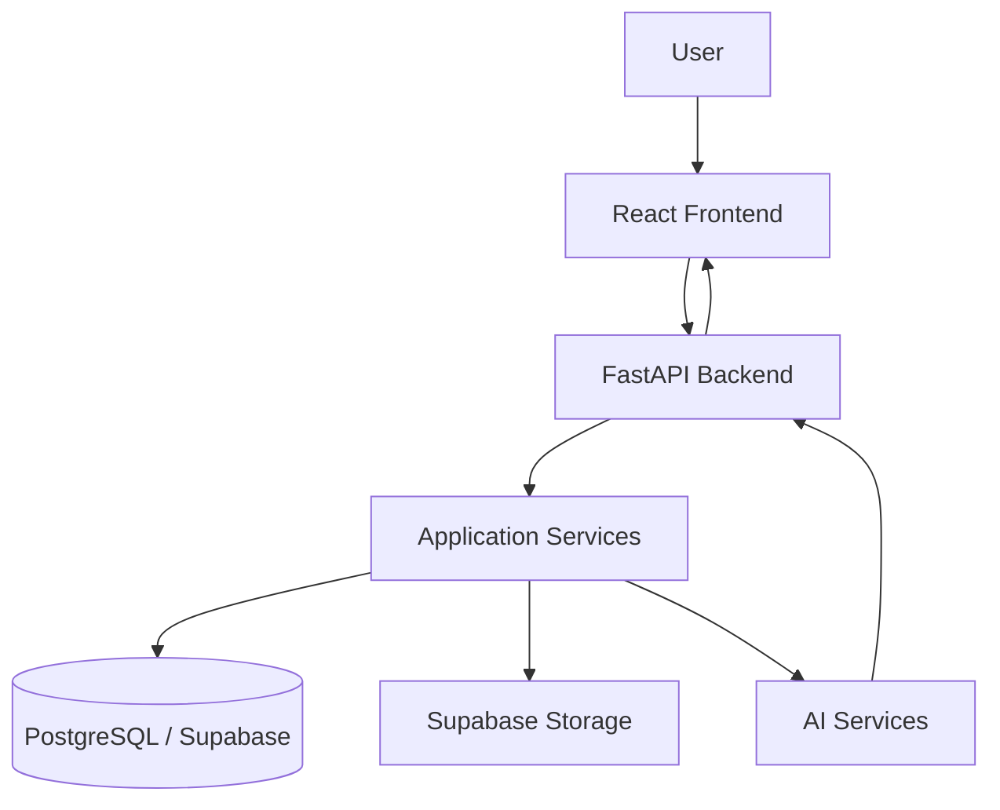
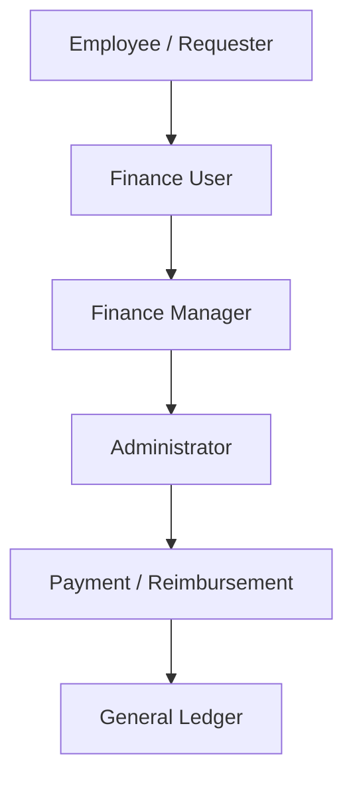

# Finance AI Agent

### Making everyday finance operations simpler with AI

Finance AI Agent is a project focused on bringing everyday finance activities into one place and using AI to make parts of that work easier.

Finance teams often deal with invoices, payment follow-ups, expenses, bank reconciliation, financial analysis, and reporting across different processes. This project brings those activities together through dedicated workspaces, each focused on a particular finance function.

The platform is built around eight specialized AI Employees. Each workspace has its own responsibility, helping users manage different finance tasks in a more organized way.

---

## What does the platform do?

| AI Employee | What it handles |
|---|---|
| **Accounts Payable** | Tracks supplier invoices, payment due dates, and possible duplicate invoices. |
| **Accounts Receivable** | Monitors customer outstanding balances, overdue invoices, and collection priorities. |
| **Invoice Processing** | Extracts invoice details from uploaded documents and validates the information. |
| **Reconciliation** | Compares bank statements with ledger records and highlights differences. |
| **Finance Analyst** | Helps review financial data, KPIs, and business performance. |
| **Expense Employee** | Handles expense claims and receipt verification. |
| **Financial Reporting** | Organizes financial information and supports report generation. |
| **Fraud Detection** | Highlights unusual transaction patterns that may need further review. |

These are the intended responsibilities of the workspaces. Individual capabilities may have different implementation and testing statuses.

---

## How the platform works

The frontend is built with React and communicates with a backend built using FastAPI. The backend handles application logic, API requests, database operations, and integrations.

PostgreSQL is used for structured application data, with Supabase used for hosted database and storage services.



## Technology stack

| Area | Technology |
|---|---|
| Frontend | React 18, Create React App |
| Backend | Python, FastAPI |
| Database | PostgreSQL |
| ORM | SQLAlchemy |
| Database and storage platform | Supabase |
| AI Integration | Gemini API |
| Database migrations | Alembic |
| API server | Uvicorn |

---

## User roles and approval workflow

The application includes role-based access for users involved in finance operations.

The main roles are:

- **Employee / Requester** – submits invoice and expense requests.
- **Finance User** – performs initial verification and payment processing.
- **Finance Manager** – reviews and approves requests.
- **Chief Accountant** – supports financial oversight and approval responsibilities.
- **Administrator** – manages access and administrative approvals.

A typical request workflow looks like this:



The exact approval path can depend on the request type and configured role permissions.

---

## Document management

Finance operations involve invoices, receipts, statements, and other supporting documents. Document management is therefore an important part of this project.

The platform is designed to support:

- Uploading financial documents.
- Extracting invoice information.
- Validating document details.
- Previewing supported files.
- Downloading original uploaded files.
- Managing document records and access permissions.

---

## Project structure

The repository is organized into frontend and backend applications.

```text
finance-ai/
├── Frontend/
│   └── React application and workspace UI
├── backend/
│   ├── app/
│   │   ├── routes/
│   │   ├── models/
│   │   ├── services/
│   │   └── ...
│   ├── alembic/
│   └── tests/
├── IMPLEMENTATION_PLAN.md
├── IMPLEMENTATION_AUDIT.md
├── IMPLEMENTATION_STATUS.md
├── INTEGRATION_SETUP.md
└── README.md
```

For more details about implementation progress and remaining work, refer to the documentation files in the repository.

---

## Running the project locally

For complete setup and integration instructions, refer to **[INTEGRATION_SETUP.md](INTEGRATION_SETUP.md)**.

### Backend setup

```bash
cd backend

python -m venv .venv

source .venv/bin/activate

pip install -r requirements.txt
```

Copy `backend/.env.example` to `backend/.env` and configure the required values locally.

Start the backend:

```bash
uvicorn app.main:app --reload --host 127.0.0.1 --port 8000
```

API documentation:

`http://127.0.0.1:8000/docs`

### Frontend setup

Open another terminal:

```bash
cd Frontend

npm install
```

Configure `Frontend/.env.local` using the provided example file, then run:

```bash
npm start
```

---

## Current development status

Finance AI Agent is still an implementation work-in-progress and is not presented as a production-certified release.

External integrations such as Stripe and SMTP require credentials and test-mode verification. Database migrations should also be tested against a disposable PostgreSQL database before deployment.

The following files contain additional project details:

- [Implementation Plan](IMPLEMENTATION_PLAN.md)
- [Implementation Audit](IMPLEMENTATION_AUDIT.md)
- [Implementation Status](IMPLEMENTATION_STATUS.md)
- [Integration Setup](INTEGRATION_SETUP.md)

---

## Configuration and security

Keep actual credentials in local environment files only.

Never commit database passwords, API keys, Supabase service-role keys, or authentication secrets to GitHub. Example environment files should contain placeholder values rather than live credentials.

---

## About the project

Finance AI Agent is being developed as a centralized workspace for finance operations, with the aim of making routine processes easier to manage and giving finance teams a clearer view of their work.

**Developer:** Bala

**GitHub:** [@bala0525](https://github.com/bala0525)

**Repository:** [github.com/bala0525/finance-ai](https://github.com/bala0525/finance-ai)

---

*Working towards simpler finance workflows, one AI Employee at a time.*
